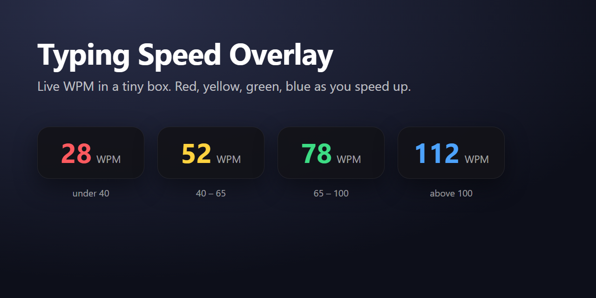

<div align="center">

# ⌨️ Typing Speed Overlay

**Your live typing speed in a tiny box that floats over every app.**
Red → yellow → green → blue as you speed up. Windows, macOS, Linux.

[](https://github.com/ddivyanshsharmaa/typing-speed-overlay/releases/latest)
[](LICENSE)
[](https://github.com/ddivyanshsharmaa/typing-speed-overlay/actions)




</div>

## Download

| System | Get this from the [latest release](https://github.com/ddivyanshsharmaa/typing-speed-overlay/releases/latest) |
| --- | --- |
| Windows | `Typing.Speed.Overlay.Setup.<version>.exe` (installer) or `Typing.Speed.Overlay.<version>.exe` (portable) |
| macOS (Apple Silicon) | `Typing.Speed.Overlay-<version>-arm64.dmg` |
| Linux | `.AppImage` or `.deb` |

The builds are **not code-signed** (certificates cost money), so on first run:
**Windows:** SmartScreen may say "unknown publisher". Click *More info*, then *Run anyway*.
**macOS:** right-click the app, choose *Open*, then confirm.

## Why this one

- **Just the number.** No window chrome, no stats screen. Drag it where you like; hover for a ✕ to close it.
- **Steady, not twitchy.** A plain average of the last 5 seconds, refreshed once a second.
- **A game, if you want one.** Under 40 is red, 40 to 65 yellow, 65 to 100 green, above 100 blue.
- **Private by design.** It keeps only the *time* of each key press for 5 seconds. Never which key, never what you type, no network access. The whole app is a handful of small files in [`src/`](src/), so you can read it in minutes.
- **Light on the machine.** About 1% of one CPU core while idle, and around 230 MB of RAM (that is Electron's baseline). It never starts by itself; it only runs when you open it.
- **Free and open source** under the MIT license.

Tray icon: hide/show, pause counting, quit.

## Platform notes

- **macOS:** grant Accessibility / Input Monitoring permission the first time, or it cannot see keys. Intel Macs: run from source.
- **Linux:** needs X11. Wayland blocks global key listening by design, so use an X11 session or XWayland.
- **Windows:** it cannot see keys typed into apps running as administrator unless the overlay is too.

## Run from source

```
npm install
npm start
```

Tests: `npm test`. Build installers: `npm run dist`.

## How speed is counted

Net WPM = (typed characters − backspaces) / 5 / minutes. Letters, digits, space and punctuation count;
shortcuts (Ctrl/Alt/Cmd), arrows and function keys do not.

## Contributing

Issues and pull requests are welcome. Ideas that fit: Intel Mac and Linux ARM builds, a settings
panel for the colour thresholds, an optional accuracy readout.

## License

[MIT](LICENSE)
